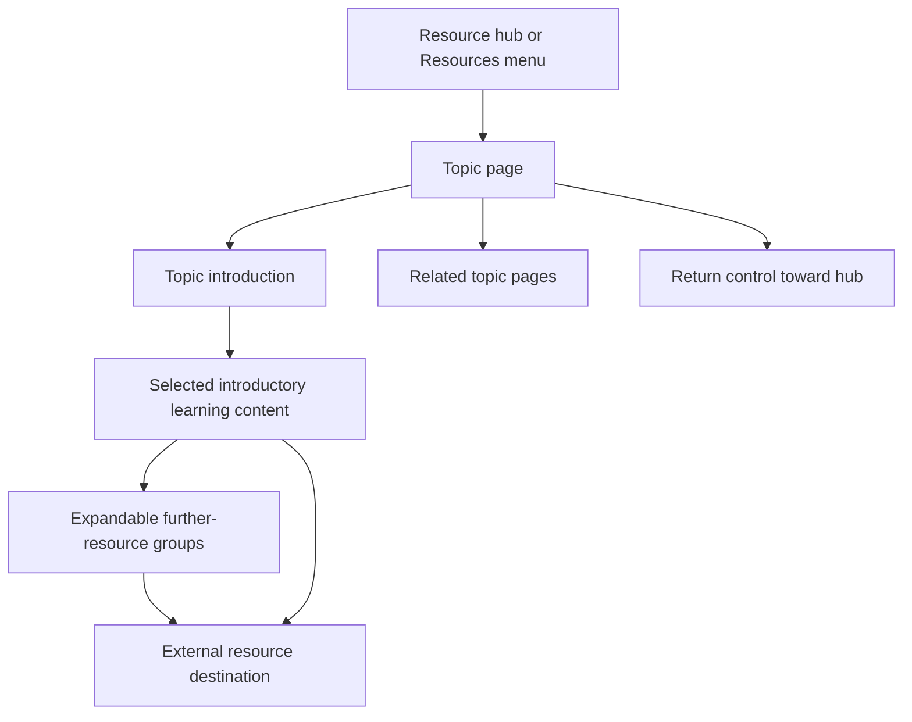

# Information Architecture: Published Structure and Resource Model

[Project overview](../README.md) · [Live website evidence](LIVE_SITE.md) · [Maintenance guide](MAINTENANCE.md)

The current public website is the reference for the page hierarchy below. The earlier content taxonomy is preserved as planning context. Resource metadata and future improvements are labeled separately.

## 1. Published page hierarchy

The [resource hub](https://carolinaadvocates.org/resources) displays five main topic entries. The site’s Resources menu also links to Planetary Health, which was not one of those five main hub entries during the review.

```text
Resource hub /resources
├── Clinical Impacts /resources-ci
├── Health System Decarbonization /resources-hsr
├── Education & Training /resources-et
├── Equity & Justice /resources-je
└── Severe Weather Preparedness /resources-swp

Additional destination in the Resources navigation
└── Planetary Health /resources-ph
```

Each primary hub entry combines an image, a short description, and a link. Topic pages provide their own introductions, learning content, further resources, and links to related topics.

This is the reviewed resource-area structure, not a complete sitemap of the organization’s website.

## 2. Observed topic-page pattern



The diagram describes a content journey, not a compulsory click sequence. A visitor can move directly to a relevant resource or another topic.

| Topic | Additional resource groups visible in the interface |
| --- | --- |
| Clinical Impacts | Academic articles, web resources, videos |
| Health System Decarbonization | Academic articles, web resources, videos |
| Education & Training | Web resources |
| Equity & Justice | Academic articles, web resources, videos |
| Severe Weather Preparedness | Academic articles, web resources, videos |
| Planetary Health | Academic articles, web resources |

The Education & Training group was expanded successfully. The presence of group controls on the other pages was observed; a complete interaction audit was not performed.

Known link inconsistencies are recorded in [LIVE_SITE.md](LIVE_SITE.md#maintenance-observations). A visible return control is not proof that its current destination is correct.

## 3. Earlier planning taxonomy

The source document *Web Resource Categories (from CACHE)* organized the resource inventory into six broad categories:

| Planning category | Included scope in the source |
| --- | --- |
| Climate & Health | Planetary health, heat, extreme weather, air pollution, infectious diseases, food/water security, and mental health |
| Healthcare Industry and Climate Change | Sector impacts, decarbonization/sustainability, and preparedness/resilience |
| Climate Education & Curriculum Development | Learning and teaching resources |
| Climate & Health Equity | Equity-related resources |
| Climate & Health Advocacy | Advocacy-related resources |
| Other Climate & Health Organizations | Related organizations |

The resource mapping document uses this framework with some variant labels and repeated destinations. It helps explain the content-review work, but it should not be presented as the current page navigation.

The final browsing structure draws on overlapping subject areas rather than a documented one-to-one renaming of every planning category. For example, planetary health has its own navigation destination, while the primary hub presents five selected topics.

## 4. Proposed resource fields

The following editorial fields develop the project’s content and sustainability requirements. They are recommendations for a working inventory, not an export of a live CMS or a claim that every field appears on every published resource.

| Field | Use |
| --- | --- |
| Title | A meaningful resource name. |
| URL | The intended destination, using a canonical address where possible. |
| Source / publisher | Who produced or maintains the material. |
| Short description | What the visitor will find and why it may be useful. |
| Published topic page | Where the item appears in the current website structure. |
| Topic tags | Additional subject terms for editorial organization. |
| Intended audience | Useful audience cues; not a restriction on access. |
| Format | Article, website, video, toolkit, PDF, dataset, or another verified type. |
| Geographic scope | Supported local, regional, national, or global context. |
| Publication / update date | The resource’s own date, where available. |
| Last reviewed | When a maintainer checked the listing. |
| Access notes | Known sign-in, paywall, download, or other conditions. |
| Placement | Introductory selection or further-resource group. |
| Owner and review status | Responsibility for checking and approving the listing. |

Keep publication dates separate from editorial review dates. If a resource appears in both introductory and additional content, manage it as the same destination rather than reporting each placement as a unique resource.

## 5. Future improvements and review priorities

- Keep hub entries, navigation menus, related-topic links, and return destinations consistent.
- Review whether a topic available in the menu also needs a main hub entry; do not assume that every destination must have one.
- Add source, format, date, or audience context where it helps a visitor choose a resource.
- Check link labels, keyboard focus, reading order, and small-screen presentation before publishing changes.
- Evaluate any proposed filtering against Squarespace capabilities and the team’s maintenance capacity.

Audience, region, and custom multi-filter browsing remain design possibilities. They are not described as delivered features of the reviewed site.
