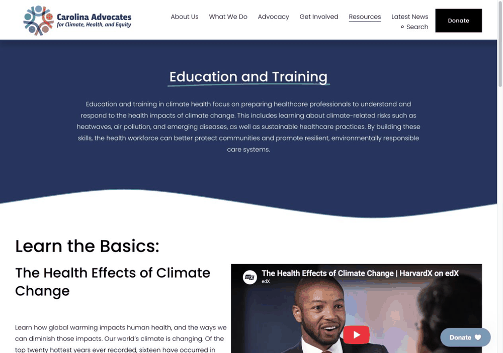
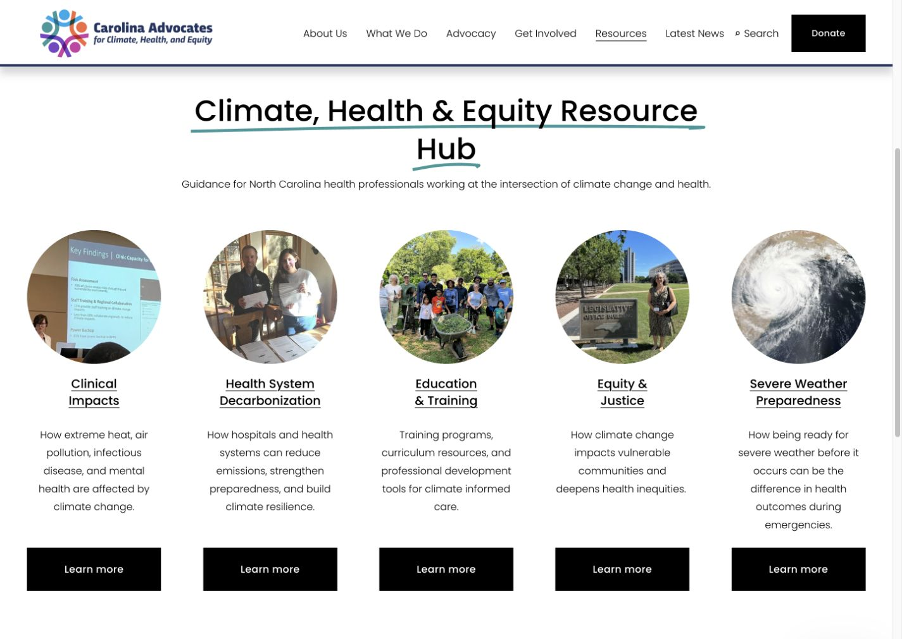
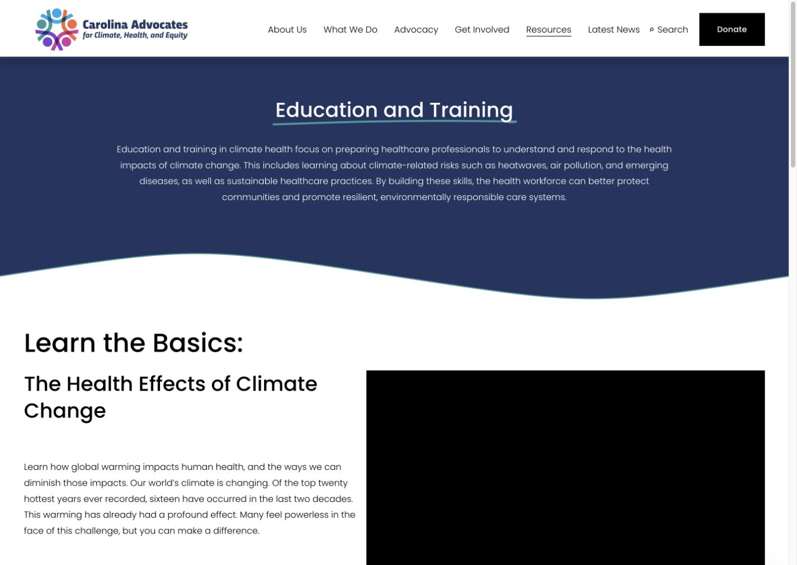
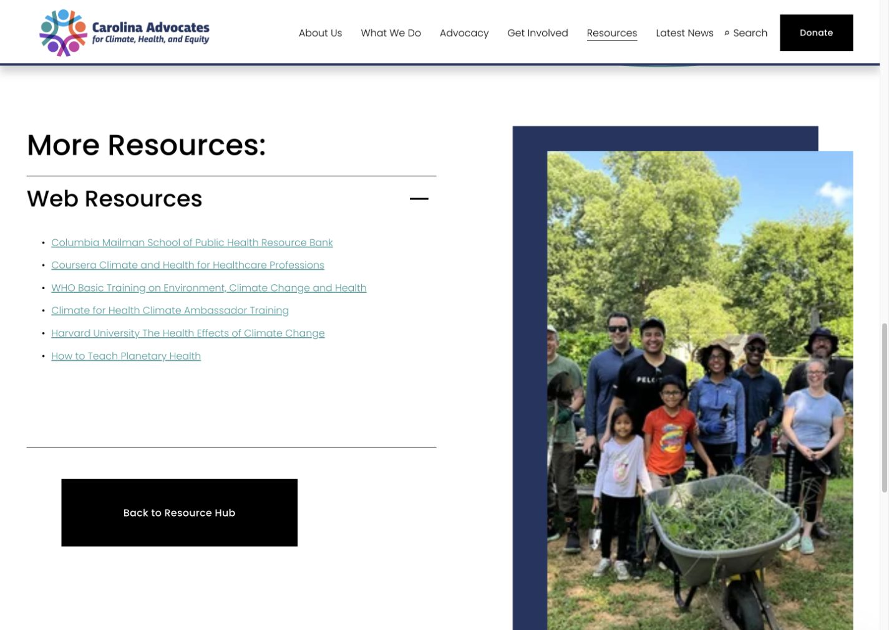

# Published Website and Interface Evidence

[Project overview](../README.md) · [Case study](CASE_STUDY.md) · [Information architecture](INFORMATION_ARCHITECTURE.md)

**Review date:** October 29, 2026. This is a record of the public interface reviewed on that date; the organization may update the website later.

## Clickable animated preview

[▶ Open the live website ↗](https://carolinaadvocates.org/resources-et)

This short, looping GIF shows a recorded scroll through the Education & Training page and expansion of its web-resource list. Click the preview to use the actual website. The animation was captured on October 30, 2026; it is a demonstration, not an embedded interactive webpage. Static screenshots below also link to their matching live pages.

## Live entry points

- [Resource hub](https://carolinaadvocates.org/resources)
- [Education & Training — the project page supplied by Chloe Jian](https://carolinaadvocates.org/resources-et)

The resource hub contains five primary topic destinations. The Resources navigation also exposes a Planetary Health page. All destinations listed below loaded their named topic content during the review.

| Destination | URL | Observed structure |
| --- | --- | --- |
| Resource hub | [/resources](https://carolinaadvocates.org/resources) | Topic introduction, five illustrated topic entries with descriptions, and an embedded introductory video. |
| Clinical Impacts | [/resources-ci](https://carolinaadvocates.org/resources-ci) | Introductory material, further resources grouped as articles/websites/videos, and related topics. |
| Health System Decarbonization | [/resources-hsr](https://carolinaadvocates.org/resources-hsr) | Introductory material, further resources grouped as articles/websites/videos, and related topics. |
| Education & Training | [/resources-et](https://carolinaadvocates.org/resources-et) | Topic introduction, selected learning resources, an expandable web-resource list, and related topics. |
| Equity & Justice | [/resources-je](https://carolinaadvocates.org/resources-je) | Introductory material, further resources grouped as articles/websites/videos, and related topics. |
| Severe Weather Preparedness | [/resources-swp](https://carolinaadvocates.org/resources-swp) | Introductory material, further resources grouped as articles/websites/videos, and related topics. |
| Planetary Health | [/resources-ph](https://carolinaadvocates.org/resources-ph) | Accessible from the Resources menu; introductory material and further articles/web resources. |

## Resource hub

The hub makes topics the primary way into the collection. Each main topic is represented with an image, a short explanation, and a link to its dedicated page. The five hub entries and the additional navigation destination are distinguished in the [page hierarchy](INFORMATION_ARCHITECTURE.md#1-published-page-hierarchy).

## Education & Training: introductory content

The page begins with a topic introduction and a prominent basics section. The featured learning material includes an embedded course video and links to external training and resource providers. This demonstrates the introductory layer without requiring every resource to be visible in one long initial list.

## Education & Training: expanded resource list

The additional web-resource group was expanded through its visible control. Its list became visible and the control changed to an expanded state. This confirms the interaction on this page; it does not establish that every accordion or external destination across the website was tested.

## Observable delivery and unmeasured effects

| Supported by the public interface | Requires additional evidence |
| --- | --- |
| A published hub and named topic pages. | The exact launch date and implementation history of every change. |
| An introductory section followed by further resources. | Reduced search time or cognitive load measured with users. |
| Format-based resource groups on several topic pages. | Higher task completion, satisfaction, or engagement. |
| An Education & Training accordion that opens. | Complete keyboard, screen-reader, mobile, or cross-browser conformance. |
| Related-topic links and hub-return controls. | A claim that every link is correct or every resource has been reviewed. |

## Maintenance observations

Two concrete navigation issues were observed and are retained as follow-up work:

1. **Education & Training hub-return destination.** Its return control points to `https://carolinaadvocates.org/resources1`, which displayed the site’s not-found page. The working hub destination observed in the main navigation is `https://carolinaadvocates.org/resources`.
2. **Decarbonization page related-topic destination.** A link labeled for severe-weather preparedness points back to `/resources-hsr`. The separately loaded preparedness page is `/resources-swp`. The label and destination should be reconciled.

These observations concern the public interface at review time. This documentation update did not modify the client website.

## Screenshot scope and attribution

The static screenshots are browser captures of the public website at a 1440 × 1100 desktop viewport. A site announcement was dismissed for the captures; resource-list expansion is shown explicitly. No source-page content, imagery, colors, or labels were edited for the screenshots.

They are included as evidence of the interface discussed in this portfolio case study. CACHE branding, existing imagery, graphics, and embedded third-party content retain their original attribution and rights. See [Credits](../CREDITS.md).
